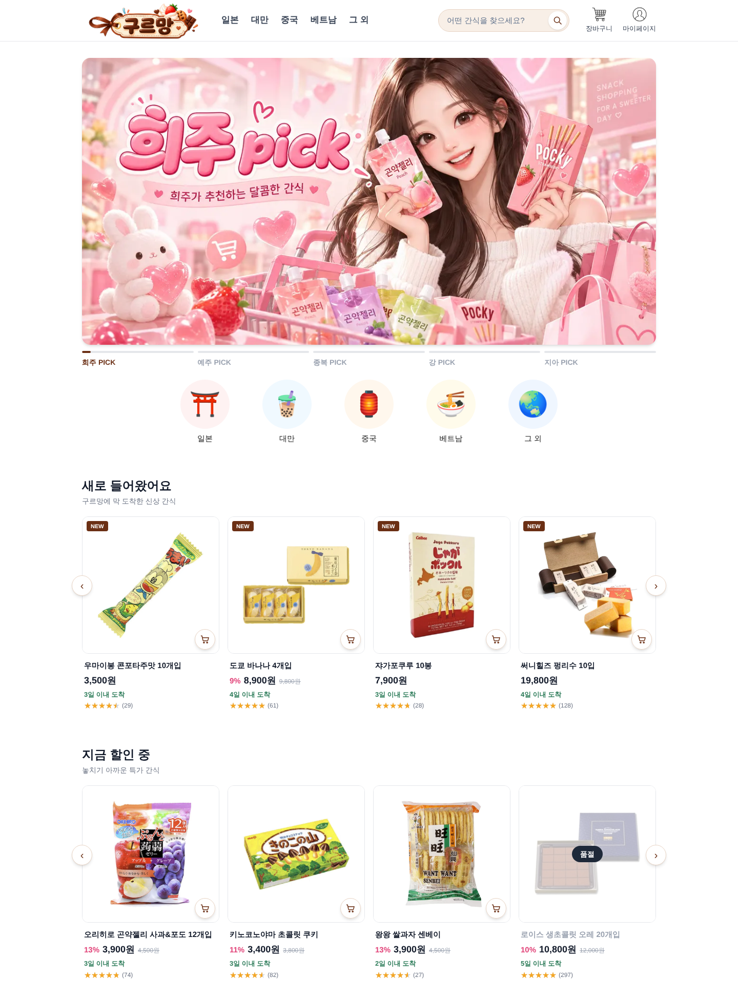
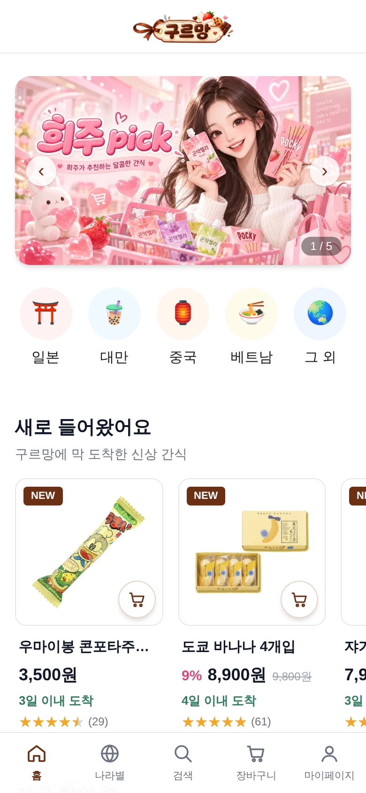
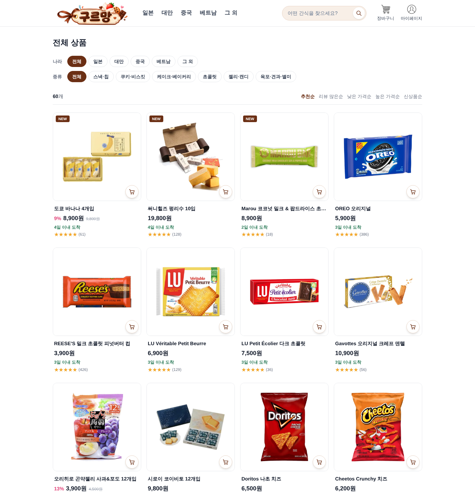
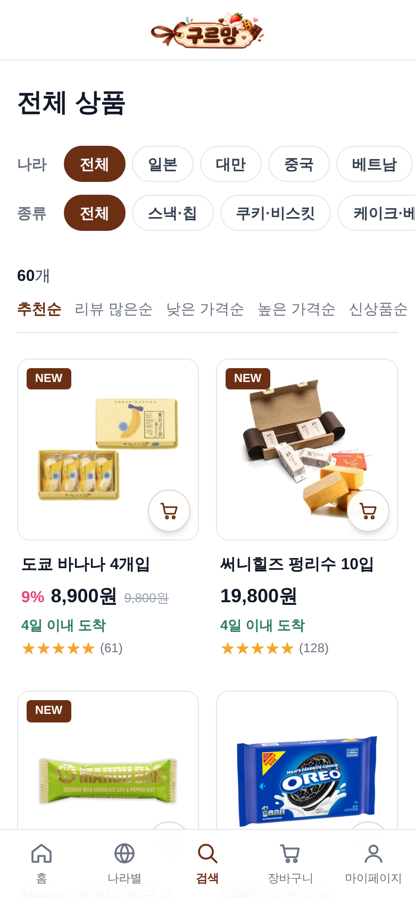
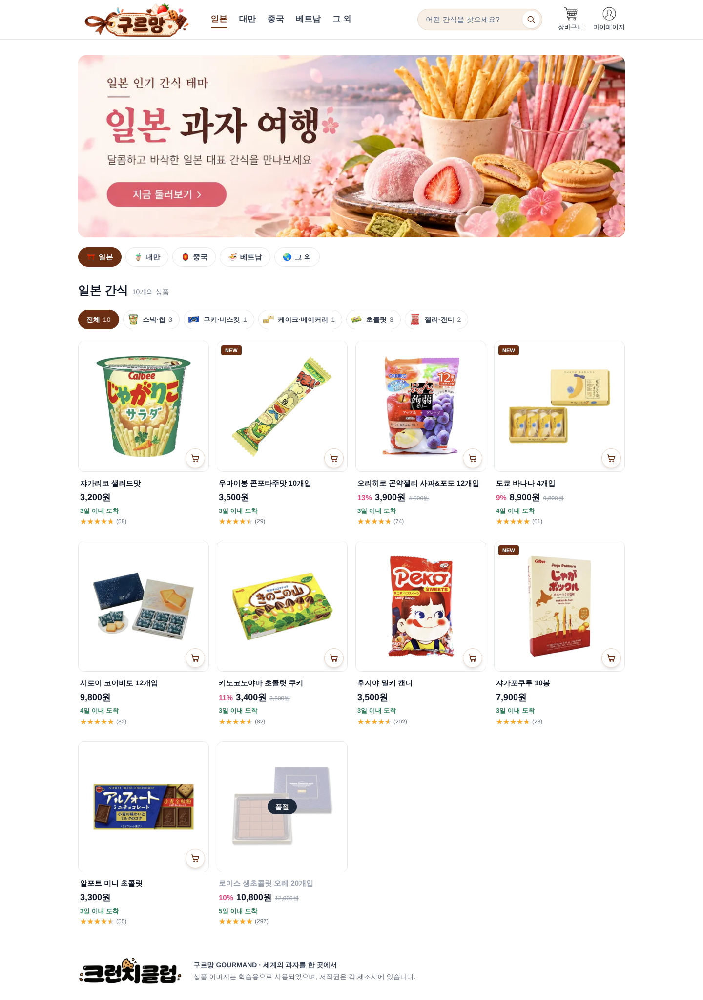
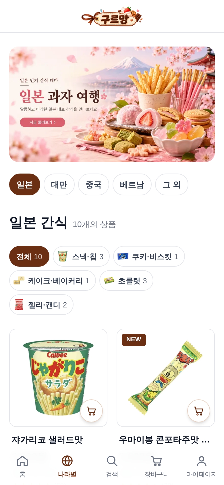
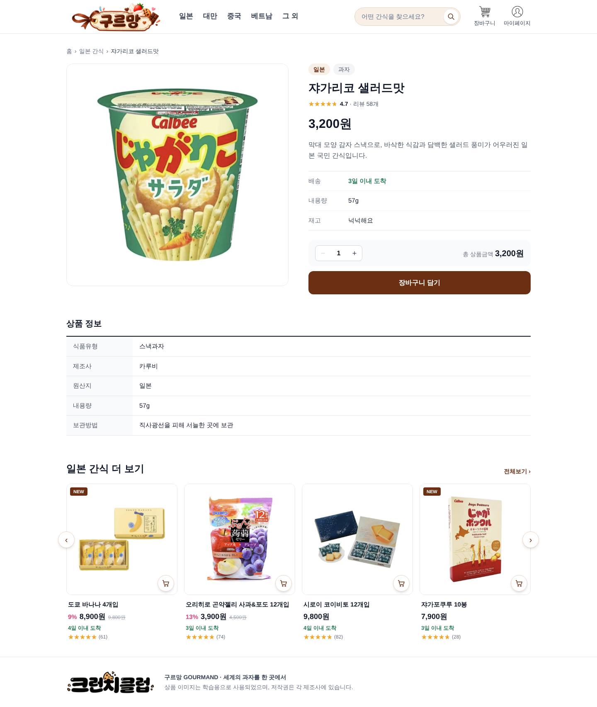

# 🍪 구르망 GOURMAND

> 세계의 과자를 한 곳에서, **세계 과자 할인점 온라인 쇼핑몰**

팀 **크런치클럽** (4명) · 부트캠프 팀 프로젝트

<br>

## 1. 프로젝트 소개

### 주제

해외여행에서 사 오던 그 나라 간식을 집에서 편하게 주문할 수 있는 **세계 과자 온라인 쇼핑몰**입니다.
오프라인 '세계 과자 할인점'을 온라인으로 옮겨, 일본·대만·중국·베트남·그 외 나라(미국·프랑스)의 과자 60종을 **나라별·카테고리별**로 둘러보고 구매할 수 있습니다.

### Use Case: 상품 탐색부터 주문까지

사용자가 **나라별로 과자를 둘러보고 → 원하는 상품을 찾아 → 장바구니에 담고 → 주문하는** 쇼핑 흐름 전체를 구현했습니다.

```
메인 ─┬─ 나라별 (일본 · 대만 · 중국 · 베트남 · 그 외)
      ├─ 카테고리 (스낵·칩, 쿠키·비스킷, 케이크·베이커리, 초콜릿, 젤리·캔디, 육포·견과·별미)
      ├─ 검색
      └─ PICK (팀원 추천 큐레이션)
            ↓
      상품 목록 (나라·종류 필터, 정렬)
            ↓
      상품 상세 (상품 정보, 수량 선택)
            ↓
      장바구니 → 주문하기 → 주문 완료 → 마이페이지(주문 내역)
```

| 사용자 시나리오 | 구현 내용 |
|---|---|
| 나라별로 간식을 둘러보고 싶다 | 헤더·메인의 나라별 메뉴, 나라별 상품 페이지(`/country/[slug]`) |
| 원하는 간식을 빠르게 찾고 싶다 | 검색(띄어쓰기 무시), 나라·종류 필터, 정렬 5종(추천·리뷰 많은·낮은 가격·높은 가격·신상품) |
| 상품을 자세히 비교하고 싶다 | 할인율·별점·리뷰 수·배송일, 식품유형·제조사·원산지·보관방법 정보 |
| 담아 두었다가 한 번에 주문하고 싶다 | 장바구니(수량 변경·삭제), 배송 정보 입력, 주문 완료, 주문 내역 조회 |
| 모바일에서도 편하게 쇼핑하고 싶다 | 반응형 레이아웃(모바일 2열 ~ PC 4열), 모바일 하단 탭바 |

### 주요 기능

- **메인**: 배너 슬라이드(PICK), 나라별 아이콘 메뉴, 신상품·할인 상품 가로 스크롤, 나라별 대표 상품
- **상품 목록 / 검색**: 나라·종류 필터, 정렬, 검색어 결과
- **상품 상세**: 이미지, 할인가·정가, 별점, 배송·재고 정보, 수량 선택 후 장바구니 담기, 같은 나라 상품 추천
- **상품 카드**: NEW·할인율 뱃지, 품절 표시, 카드에서 바로 장바구니 담기
- **장바구니 · 주문 · 마이페이지**: 브라우저 저장소(`sessionStorage` / `localStorage`)에 장바구니와 주문 내역 저장
- **관리자 페이지** (`/admin`): 주문·배송 현황 대시보드 (주소로만 접근)
- **예외 화면**: 404 페이지, 오류 페이지

### 기술 스택

| 구분 | 사용 기술 |
|---|---|
| 프론트엔드 | Next.js 16 (App Router, Turbopack), React 19, TypeScript, Tailwind CSS v4 |
| 백엔드 | FastAPI, SQLAlchemy (DB 접속까지 구현) |
| 데이터베이스 | PostgreSQL (상품·나라·카테고리·리뷰 테이블 설계 및 구축) |
| 협업 | Git, GitHub (개인 브랜치 → Pull Request → main 머지) |

> **데이터 흐름**: PostgreSQL에 상품 데이터를 구축하고, DB에서 추출한 상품 60개를 `gourmand/data/products.ts`로 만들어 화면에서 사용합니다.

<br>

## 2. 컴포넌트 계층 구조도

### 공통 레이아웃

```
RootLayout (app/layout.tsx)
└── CartProvider                     # 장바구니 상태 공유 (Context)
    ├── Header                       # 로고, 나라별 메뉴, 검색창, 장바구니·마이페이지
    │   └── CartBadge                # 장바구니 수량 표시
    ├── {page}                       # 각 페이지
    ├── Footer
    └── MobileTabBar                 # 모바일 하단 탭 (홈·나라별·검색·장바구니·마이페이지)
```

### 페이지별 구조

```
app/
├── page.tsx  (/)  메인
│   ├── MainBanner                   # PICK 배너 슬라이드
│   ├── CountryMenu                  # 나라별 동그라미 아이콘 메뉴
│   ├── HomeSection "새로 들어왔어요"
│   │   └── ProductRow               # 가로 스크롤
│   │       └── ProductCard
│   │           └── AddToCartButton
│   ├── HomeSection "지금 할인 중"
│   │   └── ProductRow
│   │       └── ProductCard
│   │           └── AddToCartButton
│   └── HomeSection × 5 (나라별 간식)
│       └── ProductCard
│           └── AddToCartButton
│
├── products/page.tsx  (/products)  상품 목록
│   └── ProductResults
│       ├── ProductFilters           # 나라·종류 필터, 정렬
│       └── ProductCard
│           └── AddToCartButton
│
├── products/[id]/page.tsx  (/products/1)  상품 상세
│   ├── ProductPurchase              # 수량 선택, 장바구니 담기
│   └── HomeSection "OO 간식 더 보기"
│       └── ProductRow
│           └── ProductCard
│               └── AddToCartButton
│
├── search/page.tsx  (/search)  검색
│   └── ProductResults
│       ├── ProductFilters
│       └── ProductCard
│
├── country/[slug]/page.tsx  (/country/japan)  나라별 상품
│   ├── CountryTabs
│   ├── CategoryFilter
│   └── ProductCard
│
├── category/page.tsx  (/category)  전체 카테고리
├── category/[slug]/page.tsx  (/category/snack)  카테고리별 상품
│   ├── CategoryTabs
│   ├── SortLinks (ProductFilters)
│   └── ProductCard
│
├── pick/[slug]/page.tsx  (/pick/...)  PICK 큐레이션
│   ├── CountryMenu
│   ├── CategoryFilter
│   └── ProductCard
│
├── cart/page.tsx  (/cart)  장바구니
│   └── CartView
├── checkout/page.tsx  (/checkout)  주문하기
│   └── CheckoutForm
├── order/complete/page.tsx  (/order/complete)  주문 완료
│   └── OrderComplete
├── mypage/page.tsx  (/mypage)  마이페이지
│   └── MyOrders
│
├── admin/  (/admin)  관리자 (쇼핑몰 헤더·푸터 숨김)
│   └── AdminDashboard
│
├── not-found.tsx  404 페이지
│   ├── BittenCookie (CookieIllust)
│   ├── BackButton
│   └── ProductCard
└── error.tsx  오류 페이지
    └── BrokenCookie (CookieIllust)
```

### 폴더 구조

```
shopping_mall/
├── backend/                 # FastAPI 백엔드 (DB 접속)
└── gourmand/                # Next.js 프론트엔드
    ├── app/                 # 페이지 (App Router)
    ├── components/          # UI 컴포넌트
    ├── data/                # 상품·PICK·예시 주문 데이터
    ├── lib/                 # 상품·카테고리 공통 함수, 주문 저장
    ├── types/               # Product 타입
    └── public/images/       # 상품·공통 이미지
```

<br>

## 3. 로컬 실행 방법

> Node.js 20.9 이상이 필요합니다.

```bash
# 1. 저장소 복제
git clone https://github.com/hiju200208-png/shopping_mall.git

# 2. 프론트엔드 폴더로 이동
cd shopping_mall/gourmand

# 3. 패키지 설치
npm install

# 4. 개발 서버 실행
npm run dev
```

브라우저에서 [http://localhost:3000](http://localhost:3000)에 접속합니다.

> `npm` 명령어는 반드시 `gourmand` 폴더에서 실행해야 합니다. `shopping_mall` 폴더에서 실행하면 `package.json`을 찾지 못해 오류(ENOENT)가 납니다.

<br>

## 4. 완성 화면

### 메인 페이지 캡쳐

| PC | 모바일 |
|:---:|:---:|
|  |  |

### 상품 목록 페이지 캡쳐

| PC | 모바일 |
|:---:|:---:|
|  |  |

**나라별 상품 (메인에서 일본 아이콘 클릭 시)**

여행에서 먹었던 그 나라 간식이 생각날 때, 나라 아이콘 하나로 해당 나라 간식만 모아 볼 수 있습니다.

| PC | 모바일 |
|:---:|:---:|
|  |  |

### 상품 상세 페이지 캡쳐

| PC | 모바일 |
|:---:|:---:|
|  |  |

<br>

---

상품 이미지는 학습용으로 사용되었으며, 저작권은 각 제조사에 있습니다.
